# DialogueOrchestrator 类图

本图展示当前单 Agent、Direct 执行模式下的编排入口、直接依赖、主要数据模型，
以及平铺的历史、记忆、上下文和执行调用关系。不包含未来的多 Agent 设计。

图中只列出与本流程有关的方法；异步返回值省略外层 `Task<T>`，
参数省略 `CancellationToken`。`+` 表示 public，`~` 表示 internal，`-` 表示 private。
日志依赖和底层存储实现未展开。

编排器通过 `LocalUserContext` 解析可信 UserId，调用 Memory 读取后，
把明确的 MemoryItem 数据传给 ContextBuilder，而不是把读取藏在 Builder 内。

## 一、类与依赖关系

```mermaid
%%{init: {"theme": "base", "themeVariables": {"background": "#FFFFFF", "primaryColor": "#FFFFFF", "primaryTextColor": "#333333", "primaryBorderColor": "#B8B8B8", "secondaryColor": "#F5F5F5", "secondaryTextColor": "#333333", "secondaryBorderColor": "#CCCCCC", "tertiaryColor": "#F5F5F5", "tertiaryTextColor": "#333333", "tertiaryBorderColor": "#CCCCCC", "clusterBkg": "#F5F5F5", "clusterBorder": "#CCCCCC", "lineColor": "#888888"}}}%%
classDiagram
    direction TB

    class LocalTaskManager {
        -RunAsync(accepted, handle)
    }

    class DialogueOrchestrator {
        +RespondAsync(request) ExecutionOutcome
        ~RespondTaskAsync(request, taskId, waitingForModel) ExecutionOutcome
        -RespondCoreAsync(request, taskId, waitingForModel) ExecutionOutcome
    }

    class DialogueRequest {
        <<record>>
        +SessionId SessionId
        +string Input
        +string SystemInstruction
        +int MaxInputCharacters
        +int MaxHistoryTurns
        +ModelOptions? Options
    }

    class LocalSessionManager {
        +BeginTurnAsync(sessionId) IDisposable
    }

    class IConversationManager {
        <<interface>>
        +AppendAsync(request) ConversationMessage
        +ListBySessionAsync(request) ConversationMessagePage
    }

    class ConversationWindow {
        +SelectAsync(current, systemInstruction, maxCharacters, maxTurns) IReadOnlyList~ModelMessage~
    }

    class DirectExecutor {
        +ExecuteAsync(invocation) ExecutionOutcome
        -InterpretResponse(response) ExecutionOutcome$
    }

    class BuildContextRequest {
        <<record>>
        +string SystemInstruction
        +IReadOnlyList~ModelMessage~ Messages
        +IReadOnlyList~MemoryItem~ Memories
        +ModelOptions? Options
    }

    class IContextBuilder {
        <<interface>>
        +BuildAsync(request) ModelInvocation
    }

    class IWorkingMemoryManager {
        <<interface>>
        +ListRecentAsync(request) IReadOnlyList~MemoryItem~
    }

    class LocalUserContext {
        +GetUserIdAsync() UserId
    }

    class MemoryItem {
        <<record>>
    }

    class ModelInvocation {
        <<record>>
    }

    class ILanguageModelRuntime {
        <<interface>>
        +InvokeAsync(invocation)
    }

    class ExecutionOutcome {
        <<record>>
        +ExecutionConclusion Conclusion
        +string? Text
        +ModelFinishReason FinishReason
        +ModelUsage? Usage
        +string? ProviderFinishReason
    }

    LocalTaskManager ..> DialogueOrchestrator : resolves and calls RespondTaskAsync
    LocalTaskManager ..> DialogueRequest : creates
    LocalTaskManager ..> ExecutionOutcome : maps to terminal task result
    DialogueOrchestrator ..> DialogueRequest : accepts
    DialogueOrchestrator --> LocalSessionManager : acquires lease for direct calls
    DialogueOrchestrator --> IConversationManager : appends user and assistant messages
    DialogueOrchestrator --> ConversationWindow : selects history
    DialogueOrchestrator --> LocalUserContext : resolves trusted user
    DialogueOrchestrator --> IWorkingMemoryManager : reads user memories
    DialogueOrchestrator --> IContextBuilder : builds model invocation
    DialogueOrchestrator --> DirectExecutor : executes one model request
    DialogueOrchestrator ..> BuildContextRequest : creates
    DialogueOrchestrator ..> MemoryItem : passes to context builder
    DialogueOrchestrator ..> ModelInvocation : passes to executor
    DialogueOrchestrator ..> ExecutionOutcome : returns
    ConversationWindow --> IConversationManager : reads history pages
    IWorkingMemoryManager ..> MemoryItem : returns
    IContextBuilder ..> BuildContextRequest : accepts
    IContextBuilder ..> ModelInvocation : returns
    DirectExecutor ..> ModelInvocation : accepts
    DirectExecutor --> ILanguageModelRuntime : invokes model
    DirectExecutor ..> ExecutionOutcome : creates
```

实线箭头表示持有的注入依赖，虚线箭头表示调用或数据使用关系。
这些关系不表示编排器私有拥有相关服务，也不表示每次执行都创建一套服务。

## 二、两个入口的区别

| 入口 | 使用方式 | 会话占用 |
|---|---|---|
| `RespondAsync` | 不携带业务 TaskId 的直接调用 | 通过 `BeginTurnAsync` 获取 lease，退出作用域时释放。 |
| `RespondTaskAsync` | 由任务管理器的后台流程调用 | 会话已在创建业务任务时占用，不重复获取 lease；由任务完成逻辑释放。 |

两个入口都进入私有的 `RespondCoreAsync`，复用同一套对话执行流程。
该方法作为流程骨架，通过同类内的 private 阶段方法组织实现细节；
图中省略这些辅助方法，不引入基类或继承扩展点。
会话 lease、日志范围和阶段异常处理仍由流程骨架统一管理。

任务入口还接收 `waitingForModel` 回调：

- 编排器准备进入执行器前调用它。
- 当前由任务管理器提供回调，将业务任务更新为 `WaitingForModel`。
- 编排器不直接依赖任务 Store；业务任务终态也由任务管理器保存。

`WaitingForModel` 的更新发生在上下文构造成功之后、调用执行器之前，
不能将它理解为网络请求已经发送的精确时间点。

## 三、主流程与职责分工

1. **校验请求**：检查请求和用户输入。
2. **处理会话占用**：根据入口决定是否获取会话 lease。
3. **保存用户消息**：调用 Conversation，保存输入并获得带序号的当前消息。
4. **选择历史**：ConversationWindow 按字符预算和轮次限制选择历史，
   连同本次输入生成模型消息。
5. **读取记忆**：解析可信用户，直接调用 Memory 读取最近最多 20 条有效 User 记忆，检查返回归属。
6. **构造上下文**：直接调用 ContextBuilder，传入系统指令、消息、记忆及选项，得到 ModelInvocation。
7. **执行模型请求**：调用可选的等待模型回调并检查取消；DirectExecutor 接收 ModelInvocation，
   调用 LanguageModelRuntime，再把响应解释为 ExecutionOutcome。
8. **保存 Assistant 消息**：保存文本、结束原因等信息，然后返回 outcome。

特殊情况：

- 若 outcome 为 `UnsupportedAction`，直接返回，不把工具调用响应误存为纯文本 Assistant 历史。
- 保存回复失败时不重新调用模型；当前流程没有自动重试。
- 取消和异常向上传播；任务管理器负责业务任务失败或取消的终态处理。

## 四、当前设计边界

- **TaskManager** 管业务任务生命周期；**DialogueOrchestrator** 管一次对话执行的步骤。
- **Conversation** 保存消息；**ConversationWindow** 选择本次使用的历史；
  **ContextBuilder** 构造模型调用上下文。
- Memory、Context 和 Execution 是编排器直接协调的平级能力。
  ContextBuilder 不访问 Memory 服务，DirectExecutor 不构造 Context。
- 当前没有语义召回、Skills 或工具执行循环。
- 当前不存在显式 `Agent` 类，也不需要为此类图引入新抽象。

## 五、代码入口

- [LocalTaskManager](../../HanyingAgent/SRC/Runtime/Tasks/LocalTaskManager.cs)
- [DialogueOrchestrator](../../HanyingAgent/SRC/Runtime/Orchestration/DialogueOrchestrator.cs)
- [DialogueRequest](../../HanyingAgent/SRC/Runtime/Orchestration/DialogueRequest.cs)
- [LocalSessionManager](../../HanyingAgent/SRC/Runtime/Sessions/LocalSessionManager.cs)
- [IConversationManager](../../HanyingAgent/SRC/Contracts/Conversation/Operations/IConversationManager.cs)
- [ConversationWindow](../../HanyingAgent/SRC/Runtime/Context/ConversationWindow.cs)
- [DirectExecutor](../../HanyingAgent/SRC/Runtime/Execution/DirectExecutor.cs)
- [IWorkingMemoryManager](../../HanyingAgent/SRC/Contracts/Memory/Operations/IWorkingMemoryManager.cs)
- [LocalContextBuilder](../../HanyingAgent/SRC/Runtime/Context/LocalContextBuilder.cs)
- [ExecutionOutcome](../../HanyingAgent/SRC/Contracts/Execution/Models/ExecutionOutcome.cs)
- [业务任务管理类图](TaskModel.md)
