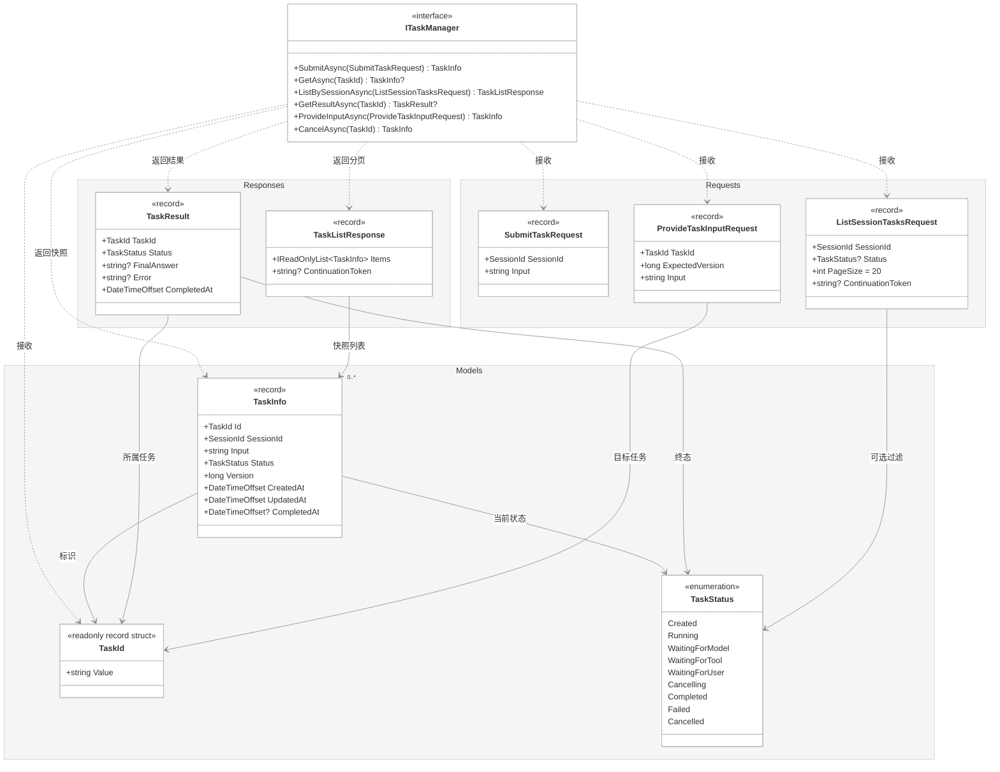
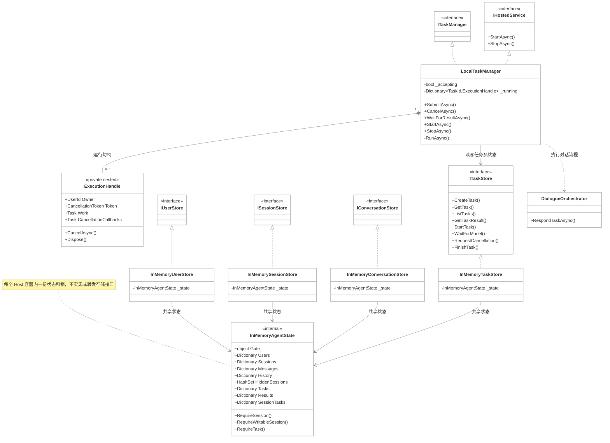

# Task Contracts 类图

本图展示 [Contracts/Tasks](../../HanyingAgent/SRC/Contracts/Tasks/Tasks.md)
中的公共接口、请求、响应与业务模型，并补充任务管理与存储实现的关系。

图中接口返回值省略外层 `Task<T>`；所有接口方法均为异步方法，
并接收 `CancellationToken`。`SessionId` 来自 Sessions 契约，未展开其定义。



## 任务管理与存储实现类图



上图省略日志、时钟、配置等辅助依赖，状态集合省略泛型参数；
`History` 按 SessionId 保存 `List<ConversationMessage>`，
`SessionTasks` 按 SessionId 保存 `List<TaskId>`。

### Store 的实现分工

| 文件 | 职责 |
|---|---|
| [InMemoryUserStore.cs](../../HanyingAgent/SRC/Infrastructure/Persistence/InMemoryUserStore.cs) | 仅实现 IUserStore。 |
| [InMemorySessionStore.cs](../../HanyingAgent/SRC/Infrastructure/Persistence/InMemorySessionStore.cs) | 仅实现 ISessionStore，管理会话及 TurnLease。 |
| [InMemoryConversationStore.cs](../../HanyingAgent/SRC/Infrastructure/Persistence/InMemoryConversationStore.cs) | 仅实现 IConversationStore，管理消息与历史分页。 |
| [InMemoryTaskStore.cs](../../HanyingAgent/SRC/Infrastructure/Persistence/InMemoryTaskStore.cs) | 仅实现 ITaskStore，管理任务状态、结果及分页。 |
| [InMemoryAgentState.cs](../../HanyingAgent/SRC/Infrastructure/Persistence/InMemoryAgentState.cs) | 内部共享集合、锁及归属校验，不实现任何 Store 接口。 |

这是四个独立 Store 类，不再使用 partial 或实现所有接口的组合类。
管理器直接注入各自的存储接口，Store 之间不相互持有或调用。
组合根分别注册四个 Store 单例，并通过内部构造函数为它们注入同一份 InMemoryAgentState；
不同 Host 容器的状态独立。

创建任务与占用 Session、保存终态与释放 Session 仍在同一把锁中完成。
共享状态不是统一业务入口，不持有 Store，也不转发接口调用。
当前跨数据一致性仍依赖这一内存边界，拆类不等于已能将任意 Store 独立远程部署。
ExecutionHandle 属于 LocalTaskManager，不保存到共享状态。

## 契约与实现的关系

```text
Contracts/Tasks
    定义：任务是什么，外部能做什么，传递什么数据
            ↑ 实现
Runtime/Tasks
    管理：提交、执行、取消、等待和收尾
            ↓ 使用存储端口
Infrastructure/Persistence
    保存：任务记录、状态、结果以及会话占用
```

## 阅读要点

- `TaskId`：任务的唯一标识。
- `TaskInfo`：任务当前的业务快照，不是实际执行句柄。
- `TaskStatus`：任务状态；定义的状态不代表当前执行策略全部支持。
- `TaskResult`：任务最终结果，可包含回答或错误，回答文本不等于任务成功。
- `ITaskManager`：外部操作任务的公共协议；具体实现见
  [LocalTaskManager](../../HanyingAgent/SRC/Runtime/Tasks/LocalTaskManager.cs)。
- 提交返回接受快照，不等待最终结果；取消返回请求后的快照，不保证执行已经停止。
- 当前 Direct 实现不支持补充输入、等待用户或工具执行；
  `WaitForResultAsync` 是本地管理器的辅助方法，不在当前公共接口中。
- 业务契约没有名为 `Task` 的业务类。`Task<TaskInfo>` 的外层是 .NET 异步对象，
  内层 `TaskInfo` 才是业务任务快照。
